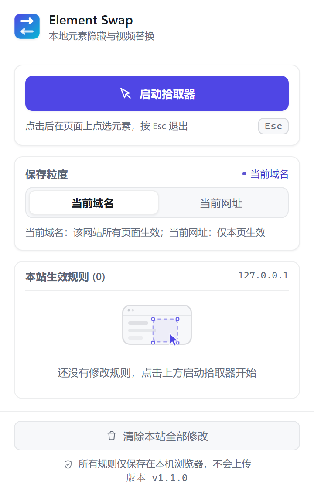
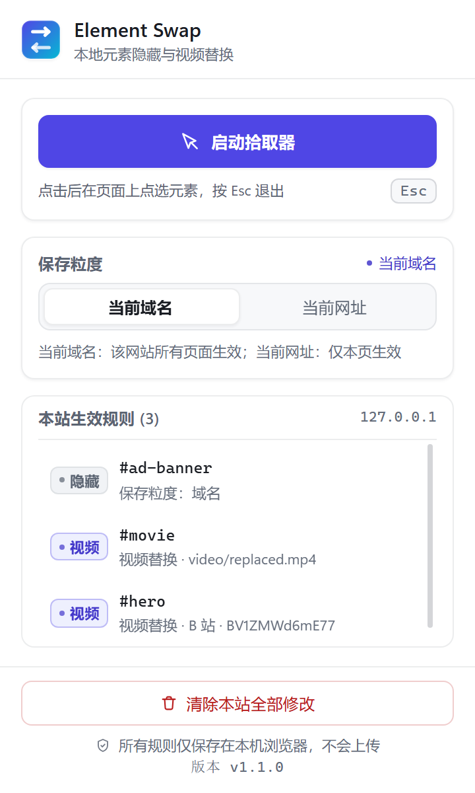
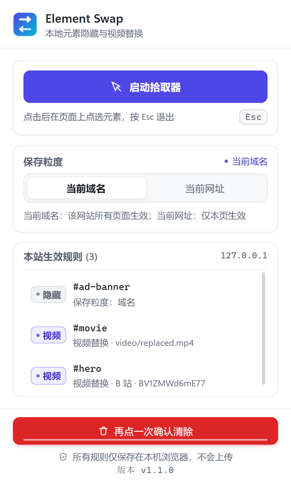
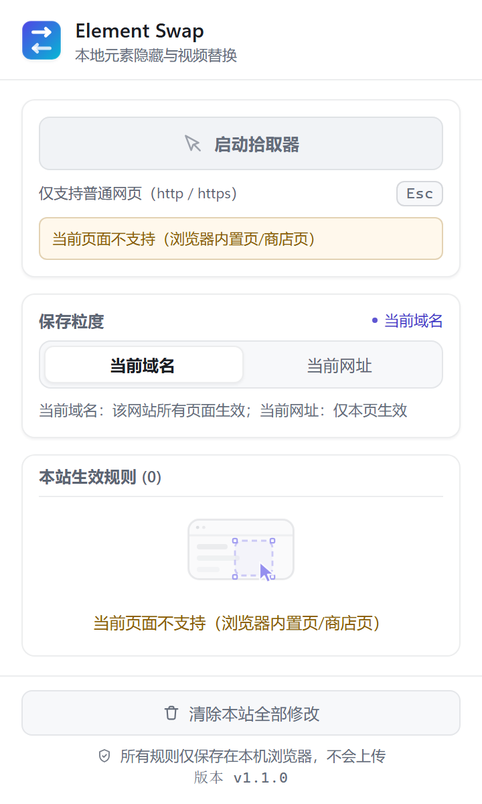
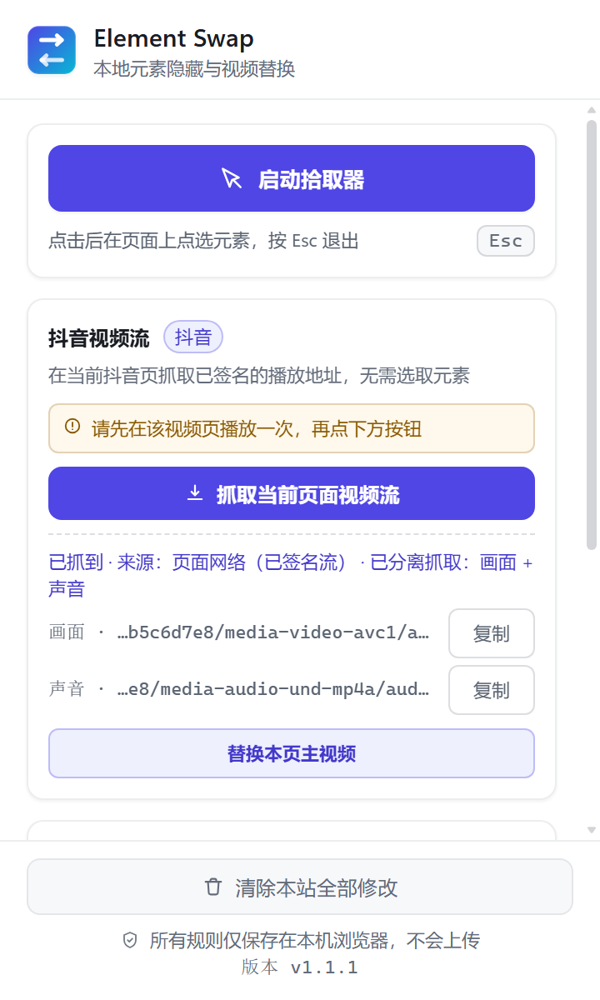
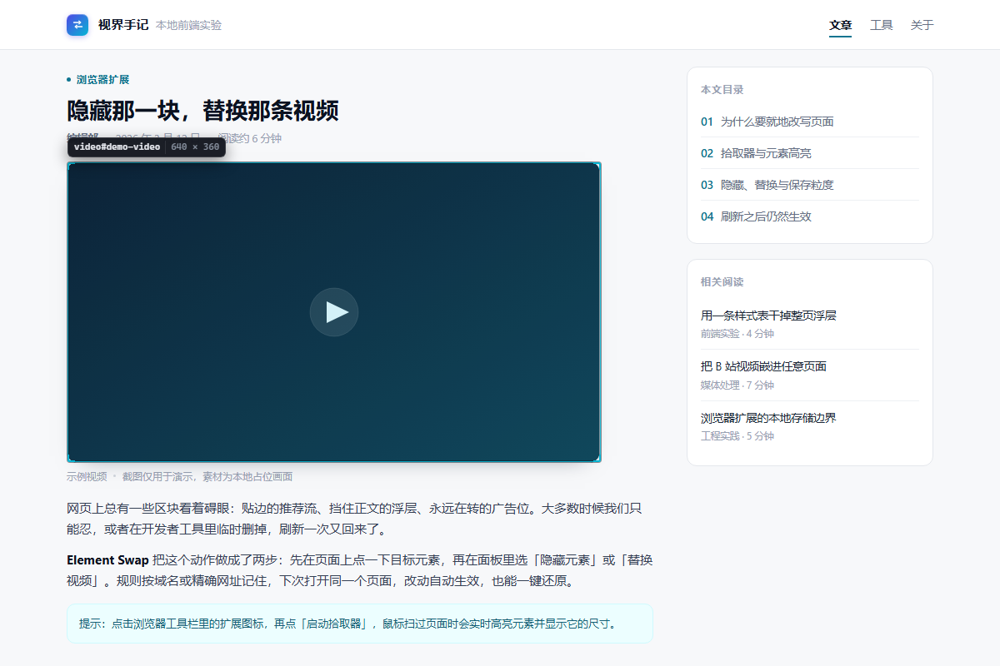
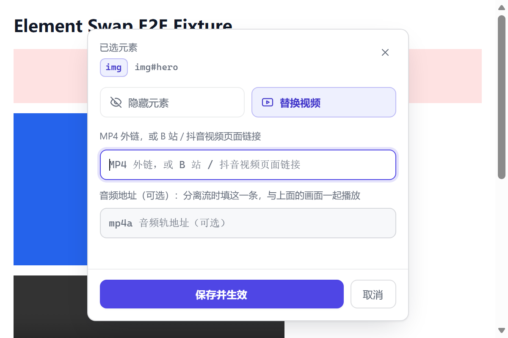
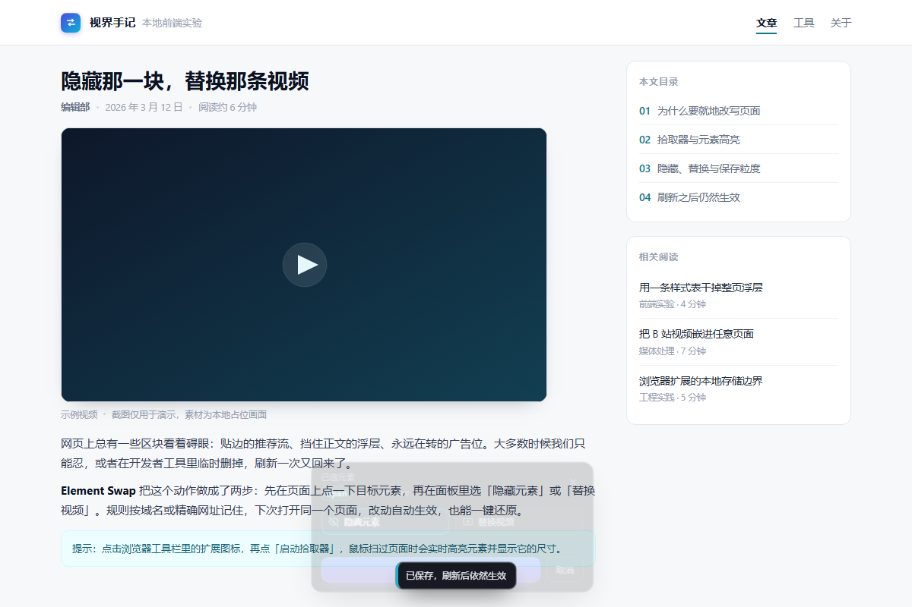
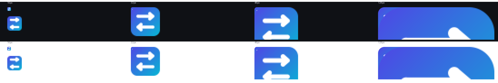

# Element Swap

> 本地网页元素隐藏 / 视频流替换工具 · Chrome / Edge 扩展（Manifest V3）
>
> 仅用于本地预览与调试：不改动网站源码，不上传任何数据。

选中页面上的任意元素一键隐藏，或把页面里的图片、视频原地换成 B 站 / 抖音的视频流。规则按「域名 / 网址」分别记住，下次打开自动生效，随时一键还原。

---

## 功能

| 能力 | 说明 |
| --- | --- |
| 可视化拾取器 | 点击工具栏图标 → 启动拾取 → 鼠标悬停即可高亮页面元素，点击选中。`Esc` 退出 |
| 元素隐藏 | 隐藏广告位、弹窗、多余区块；用内部样式表注入 `display:none !important`，刷新后依然生效 |
| 替换视频 | 选中任意元素，换成 MP4 直链；也可以把图片直接换成视频（原位插入并隐藏原元素）。**分离流**（画面与声音是两条独立地址）只需把两条整段粘进同一个输入框，扩展会自动拆成画面/声音两轨一起播放并同步 |
| 视频页面链接 | 直接粘贴 **B 站视频页链接**（`BV…` / `av…` / `b23.tv` 短链，支持 `?p=2` 分P），自动解析出可播放的媒体流 |
| 抖音页内抓流 | 在抖音页面点弹窗里的「抖音视频流」卡片，一键抓取页面已签名的流并替换本页主视频，无需选取元素。遇到分离流会**同时抓画面轨与音频轨**，并可用一个复制按钮一次复制这两条 |
| 站点独立保存 | 规则按域名或精确网址分桶保存，互不干扰 |
| 一键重置 | 清除当前页面所有修改，页面 DOM 就地还原，无需刷新 |
| 纯本地存储 | 全部规则只存在 `chrome.storage.local`；除你主动粘贴 B 站链接时的那一次官方接口解析外，不向任何服务器发送数据 |

## 界面预览

工具栏弹窗（空态 / 规则列表 / 清除确认 / 内置页禁用 / 抖音卡片）：







页内拾取与操作面板（两种操作：隐藏元素 / 替换视频）：





图标（实际尺寸与 4× 放大对照）：



## 安装（Edge）

1. 下载并解压 `element-swap-1.2.0.zip`（或直接使用本目录）。
2. 打开 `edge://extensions/`。
3. 打开左下角「开发人员模式」。
4. 点击「加载解压缩的扩展」，选择含 `manifest.json` 的目录。
5. 在工具栏「扩展」菜单里把 Element Swap 固定（图钉图标）。

Chrome 步骤相同，地址换成 `chrome://extensions/`。

## 使用

1. 打开目标网页（仅 `http` / `https` 页面生效，浏览器内置页与扩展商店页不支持）。
2. 点工具栏的 Element Swap 图标，点「启动拾取器」。
3. 鼠标悬停高亮目标，点击选中。
4. 在页内面板中选：**隐藏元素** 或 **替换视频**，填入内容后「保存并生效」。
   - 视频模式可填 MP4 直链，也可以直接粘贴 **B 站视频页链接**（`https://www.bilibili.com/video/BV1…`、`…/av170001`、`b23.tv/xxx`，带 `?p=2` 可指定分P）。
   - 在抖音页面里，视频模式会多出「抓取当前页面视频流」按钮（抖音页上面板一打开就有）；也可直接用弹窗里的「抖音视频流」卡片。
   - 抖音是 **DASH 分离流**时，仍然只有一个链接输入框：把画面、声音两条地址**整段粘进去**（换行或空格分隔都行），扩展会按轨类型自动拆分——画面轨留在输入框里、音频轨内部暂存，下方提示「已识别：画面 + 声音」，保存时两条一起生效。普通 MP4 直链与 B 站链接不受影响，行为与以前一致。两条一起播放，进度、暂停、倍速、音量都跟随画面。
5. 刷新页面验证持久化；随时在弹窗面板里删除单条规则，或「清除本站全部修改」还原。

### 保存粒度

- **当前域名**（默认）：该网站所有页面生效，例如 `example.com`。
- **当前网址**：仅当前路径生效，例如 `https://example.com/news`（忽略 `?` 参数与 `#` 锚点，避免参数抖动导致规则失效）。

两种桶会同时应用：域名规则是基础，网址规则更精细。删除规则时可从规则行的标签看出它属于哪一层。

### 同一元素重复设置

对同一个元素再次保存新规则时，会自动替换掉命中该元素的旧规则（弹窗提示「已替换该元素原有规则」），避免多条规则互相覆盖造成的静默失效。若多条规则仍指向同一元素，应用层按 `视频 > 隐藏` 的优先级抢占，并把被顶掉的规则计入冲突数，而不是记成「找不到元素」。

旧版本（1.0.0）保存过的「图片替换」「嵌入代码」规则仍留在本地存储里，但 1.1.0 起不再应用、也不在弹窗列表里显示；不会被自动删除，需要时可在旧版本里清理。

## 隐私

- 不收集、不上传任何浏览数据；无遥测、无统计、无自建服务器。
- 规则只写在本机 `chrome.storage.local`，卸载扩展即一并清除。
- **唯一的网络访问**发生在你主动把 B 站视频链接填进「替换视频」时：扩展会调用 B 站官方公开接口
  （`api.bilibili.com/x/web-interface/view`、`/x/player/playurl`）换取播放地址，不携带你的账号 Cookie，
  也不把结果发往别处；解析结果只在本机缓存 15 分钟。其余功能（隐藏、直链视频、
  抖音页面内抓流）不需要扩展主动联网，抖音的流由页面自己的请求产生。

## 目录结构

```
element-swap/
├─ manifest.json          # MV3 清单（最低 Chrome/Edge 111）
├─ background.js          # service worker：默认值、规则变更广播、媒体解析与缓存
├─ shared/
│  ├─ es-shared.js        # 契约层：存储结构、站点键、消息类型
│  └─ media-resolver.js   # B 站解析（view + playurl，含 av / 分P / 短链）
├─ rules/
│  └─ media-referer.json  # DNR 静态规则：为 B 站媒体域名补 Referer
├─ content/
│  ├─ content.js          # 拾取器、规则应用/撤销、页内面板、媒体候选池
│  └─ probe-main.js       # 抖音页面内的 MAIN world 钩子（fetch/XHR/media src）
├─ popup/                 # 工具栏弹窗：规则列表、粒度切换、清除
├─ assets/icons/          # 16/32/48/128 图标
├─ docs/screenshots/      # 界面截图
└─ tests/                 # 端到端测试夹具（不随发布包分发）
```

## 开发与测试

测试用真实 Edge 无头实例加载扩展，通过 CDP 驱动，零第三方依赖（仅 Node 内置能力）。

```bash
node tests/e2e.mjs                 # 全部用例
node tests/e2e.mjs --only=3,7       # 只跑指定用例
```

覆盖：清单静态校验、扩展加载、隐藏持久化、视频跨类型替换、撤销恢复、弹窗渲染、拾取器点选、内置页不注入、视频页面链接解析（配合 `tests/fixtures`）。

打包（只含运行时文件，排除 `tests/`）：

```bash
node tools/pack.mjs
```

## 已知限制

- **视频链接解析需要联网**：B 站走官方公开接口（`x/web-interface/view` + `x/player/playurl`），不登录时最高一般是 720p 的渐进 MP4（含音轨）；大会员/付费画质、需要登录的稿件会失败。解析结果缓存 15 分钟（`chrome.storage.session`），地址过期后重新解析即可。
- **抖音在真实站点已实测可用**（用户验证：抖音视频页抓流 → 替换本页主视频 → 正常播放），原理与限制如下：
  ①抖音只能在**当前抖音页面内**用页面自己的请求取流（MAIN world 钩子，仅注入 `*.douyin.com`），因为服务端请求只会拿到风控验证页；
  ②抓到的地址依赖抖音页面的 `Referer`/`Origin` 与时效签名，扩展已用 DNR 规则为 `douyinvod.com`/`byteicdn.com`/`zjcdn.com` 补这两个头，**但仍不能拿到别的网站复用**；
  ③地址有有效期，过期后会静默失败，此时替换后的视频会触发诊断并提示「流被防盗链拒绝 / 地址已失效，请重新抓取」——**重新抓一次即可**；
  ④抖音若大幅改版风控或播放器，抓取可能失效，届时会明确提示而不是假装成功。
⑤抖音网页播放器用 **DASH 分离流**（画面轨 `/media-video-avc1/`、声音轨 `/media-audio-und-mp4a/`），路径里的 `mime_type=video_mp4` 在音频轨上同样存在、不能作为判据，扩展只按路径段判轨。抓流会同时抓两条，点一次复制按钮即可把两条一起复制（换行分隔）；粘回面板的同一个输入框时会自动拆分。若该页只发出了画面轨，替换后会是**无声视频**（扩展不做音视频合并）。
⑥直链签名有时效（`dy_q` 等参数），过期后重新抓一次即可。
- 极严 CSP（`style-src` 不含 `inline`）的站点可能拦截内部 `<style>` 注入，隐藏规则在这种页面可能不生效。
- 隐藏规则没有元素锚点，仅按 CSS 选择器匹配；当某个隐藏选择器命中多个元素时，在其中任一元素上保存新规则会整体替换该条隐藏规则。
- SPA 页面通过 `MutationObserver`（`childList` + `subtree`）在 250ms 防抖后补应用；页面仅改动属性（非结构）不会触发重扫。
- 16px 图标做了锐度优先的笔画简化，细节弱于 32px 以上尺寸。
- 需要 Chrome / Edge **111+**（`content_scripts[].world` 键要求），清单里已声明 `minimum_chrome_version`。

## 版本

- 1.2.0 — **首个公开版本**：聚焦「隐藏元素 + 替换视频」两项通用能力（可视化拾取、隐藏、直链 MP4 / B 站链接解析 / 抖音页内抓流、DASH 双流同步、站点分桶规则、一键重置）。本版本**已移除**针对特定站点的抓流与内嵌相关能力：不再随包提供页面内 MSE 抓流探针、iframe 子框架裁剪脚本，也不再在别的页面复用「上次拾取的播放器」，后台不再动态安装改写响应头的会话规则。

- 1.1.1 — 抖音 DASH 分离流支持：抓流同时取画面轨与音频轨，**一个复制按钮一次复制两条**（换行分隔）；面板保持**只有一个链接输入框**，整段粘贴后按轨类型**自动拆分成画面/音频两轨**（音频轨内部暂存、不出现在界面上），双流一起播放且进度/暂停/倍速/音量/漂移纠偏自动同步；「先带声音起播、被拒才降级静音并提示点击开启声音」；矮窗口下操作面板完整可用。
- 1.1.0 — 聚焦「隐藏 + 替换视频」：新增 B 站链接解析（BV / av / 分P / 短链）、抖音页内一键抓流、流可用性诊断与 CDN 请求头兜底；移除图片替换与嵌入代码。
- 1.0.0 — 首个可用版本：拾取器、隐藏、图片/视频/嵌入三向替换、站点分桶、一键重置。